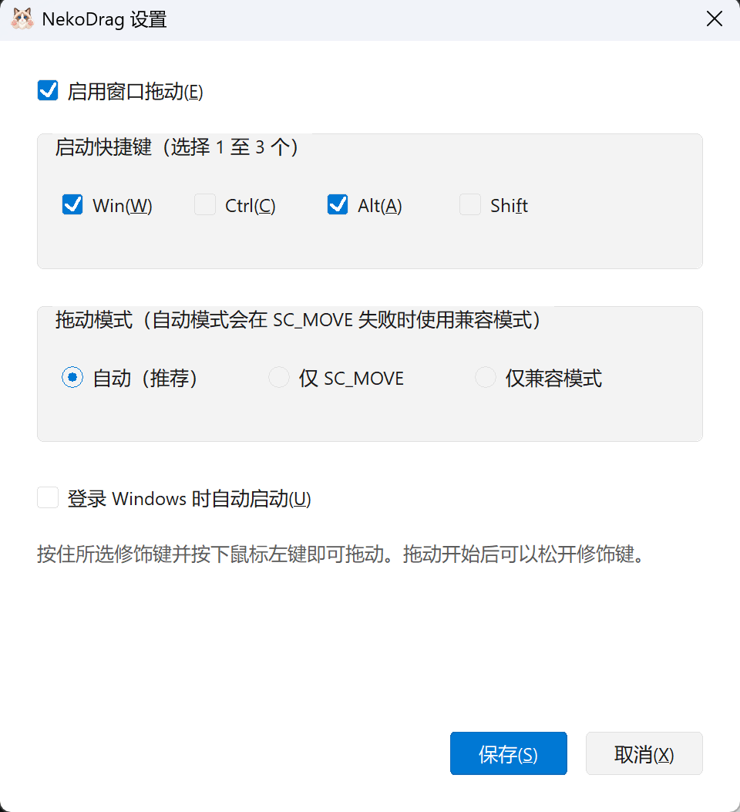

<div align="center">


# NekoDrag

**按住修饰键，从窗口任意位置拖动它 —— 不用再瞄准标题栏**

[](https://github.com/CodingLink/NekoDrag/actions/workflows/release.yml)
[](https://github.com/CodingLink/NekoDrag/releases)
[](https://github.com/CodingLink/NekoDrag)

**[中文](#中文) · [English](#english)**

</div>

---

<a id="中文"></a>
## 中文

NekoDrag 是一个 Windows 10/11 托盘小工具。按住 `Win+Alt`（可自定义），在窗口里任意位置按下鼠标左键，就能把整个窗口拖走；拖到屏幕边缘还能贴靠成半屏或四分之一屏。

单个 EXE，无需安装，无 .NET 或其他运行时依赖，以普通用户权限运行。

### 快速开始

1. 从 [Releases](https://github.com/CodingLink/NekoDrag/releases) 下载 `NekoDrag-*-windows-x64.zip`，解压。
2. 运行 `NekoDrag.exe`。首次运行会打开设置窗口，确认快捷键后保存。
3. 按住 `Win+Alt`，在任意窗口内按住左键拖动。

> 程序没有代码签名，Windows SmartScreen 可能提示「未知发布者」，点「更多信息 → 仍要运行」即可。每个 zip 都附带 `.sha256`，可用 `Get-FileHash .\NekoDrag-*.zip -Algorithm SHA256` 校验。

### 功能

**拖动**

- 在窗口任意位置按住左键即可拖动，后台窗口会被激活并置前
- 修饰键可在 Win / Ctrl / Alt / Shift 中任选 1–3 个，且必须精确匹配：设为 `Win+Alt` 时，多按一个 `Shift` 不会触发，不影响其他快捷键
- 拖动开始后可以先松开修饰键，松开左键才结束
- 拖动最大化的窗口会先恢复原尺寸，鼠标在窗口上的相对位置保持不变

**边缘贴靠**

- 拖到屏幕左 / 右边缘：贴半屏
- 拖到四个角：贴四分之一屏
- 拖到顶部边缘：最大化
- 拖动时会显示半透明预览框；再次拖动已贴靠的窗口会恢复贴靠前的大小
- 跟随 Windows 设置中的「贴靠窗口」开关；两块显示器相邻的边不会触发

**托盘菜单**

- 暂停 / 启用、打开设置、开机启动、退出

<div align="center">



</div>

### 拖动模式

设置中有三种模式，大多数情况下保持默认的兼容模式即可。

| 模式 | 工作方式 | 适合 |
| --- | --- | --- |
| **兼容模式（推荐，默认）** | NekoDrag 自己跟随鼠标移动窗口，贴靠也由 NekoDrag 完成 | 日常使用，对各类窗口最稳定 |
| **自动模式（实验）** | 先尝试让 Windows 接管拖动（与拖标题栏效果一致，含系统 Snap、跨屏 DPI 调整和 Esc 取消），失败时回退到兼容模式；Chrome / Edge / Electron 等窗口直接使用兼容模式 | 想要原生拖动体验 |
| **原生模式（诊断）** | 只使用 Windows 原生拖动，失败也不回退 | 排查问题 |

自动和原生模式会把鼠标按下传给目标窗口，因此按下位置的控件可能获得焦点或产生选中。兼容模式不会。

### 已知限制

- 无法拖动以管理员身份运行的窗口、受保护窗口、UAC 提示和安全桌面（NekoDrag 不请求提权，遇到时只提示一次）。
- 独占全屏游戏和带反作弊输入保护的软件不保证可用。
- 兼容模式不会在跨屏时按目标显示器 DPI 重新计算窗口大小，也不支持按 Esc 撤销拖动。
- 移动 EXE 位置后，直接运行一次即可更新开机启动路径。

### 从源码构建

需要 Visual Studio 2026 或 2022（「使用 C++ 的桌面开发」工作负载，含 CMake）：

```powershell
cmake -S . -B build -G "Visual Studio 18 2026" -A x64 -DBUILD_TESTING=ON
cmake --build build --config Release --parallel
ctest --test-dir build -C Release --output-on-failure
```

- 使用 VS 2022 时把生成器换成 `"Visual Studio 17 2022"`。
- 产物为 `build\Release\NekoDrag.exe`，静态链接 MSVC 运行时，可单独分发。
- 加 `-DNEKODRAG_TRACE=ON` 可构建诊断版，拖动状态通过 `OutputDebugString` 输出，用 DebugView 查看。
- 请始终使用全新的空构建目录，旧目录可能残留仓库改名前的绝对路径。

**发布新版本**：版本号只写在 `CMakeLists.txt` 的 `NEKODRAG_VERSION` 中。先改版本号并提交，再推送同名 tag（如 `v0.1.0-beta.8`），CI 会校验两者一致后构建并创建 Release。

更多实现细节见 [技术概述](docs/TECHNICAL_OVERVIEW.md)，手工验收项见 [Windows QA 清单](docs/WINDOWS_QA.md)。

---

<a id="english"></a>
## English

NekoDrag is a small Windows 10/11 tray utility. Hold `Win+Alt` (configurable), press the left mouse button anywhere inside a window, and drag the whole window. Drop it on a screen edge to snap it to a half or a quarter of the screen.

A single portable EXE: no installer, no .NET or other runtimes, runs with standard user privileges.

### Quick start

1. Download `NekoDrag-*-windows-x64.zip` from [Releases](https://github.com/CodingLink/NekoDrag/releases) and extract it.
2. Run `NekoDrag.exe`. The settings window opens on first launch; confirm the hotkey and save.
3. Hold `Win+Alt`, then press and drag with the left button anywhere inside a window.

> The binary is not code-signed, so SmartScreen may warn about an unknown publisher. Choose "More info → Run anyway". Each zip ships with a `.sha256` file; verify with `Get-FileHash .\NekoDrag-*.zip -Algorithm SHA256`.

### Features

**Dragging**

- Drag from anywhere inside a window; background windows are activated and brought to front
- Pick 1–3 of Win / Ctrl / Alt / Shift as modifiers, matched exactly: with `Win+Alt`, also holding `Shift` does not trigger, so other shortcuts keep working
- Modifiers can be released once the drag starts; the drag ends when you release the left button
- Maximized windows are restored first, keeping the pointer at the same relative spot

**Edge snapping**

- Left / right screen edge: snap to half
- Corners: snap to quarter
- Top edge: maximize
- A translucent preview shows while dragging; dragging a snapped window again restores its previous size
- Follows the Windows "Snap windows" setting; edges shared by two monitors never trigger

**Tray menu**

- Pause / resume, settings, launch at logon, quit

### Drag modes

The settings window offers three modes. The default compatibility mode is the right choice for most people.

| Mode | How it works | Best for |
| --- | --- | --- |
| **Compatibility (recommended, default)** | NekoDrag moves the window itself and handles snapping | Everyday use; most reliable across apps |
| **Auto (experimental)** | Asks Windows to take over the drag (same as dragging the title bar, including system Snap, cross-monitor DPI and Esc to cancel); falls back to compatibility if that fails. Chrome / Edge / Electron windows go straight to compatibility | A native drag feel |
| **Native only (diagnostic)** | Windows native drag only, no fallback | Troubleshooting |

Auto and native-only forward the mouse press to the target window, so the control under the pointer may gain focus or start a selection. Compatibility mode does not.

### Known limitations

- Cannot drag elevated or protected windows, UAC prompts, or the secure desktop (NekoDrag never requests elevation and shows a one-time hint instead).
- Exclusive-fullscreen games and software with anti-cheat input protection are not guaranteed to work.
- Compatibility mode does not rescale windows for a different monitor DPI and does not support Esc to undo a drag.
- After moving the EXE, run it once to update the launch-at-logon path.

### Build from source

Requires Visual Studio 2026 or 2022 with the "Desktop development with C++" workload (includes CMake):

```powershell
cmake -S . -B build -G "Visual Studio 18 2026" -A x64 -DBUILD_TESTING=ON
cmake --build build --config Release --parallel
ctest --test-dir build -C Release --output-on-failure
```

- For VS 2022, use the `"Visual Studio 17 2022"` generator.
- Output is `build\Release\NekoDrag.exe`, with the MSVC runtime linked statically, so it can ship on its own.
- Add `-DNEKODRAG_TRACE=ON` for a diagnostic build that logs drag state via `OutputDebugString` (view with DebugView).
- Always configure into a fresh, empty build directory; old ones may hold absolute paths from before the repository was renamed.

**Releasing**: the version lives only in `NEKODRAG_VERSION` in `CMakeLists.txt`. Bump and commit it, then push the matching tag (e.g. `v0.1.0-beta.8`). CI checks that they match, builds, and creates the release.

See the [technical overview](docs/TECHNICAL_OVERVIEW.md) (Chinese) for implementation details.
